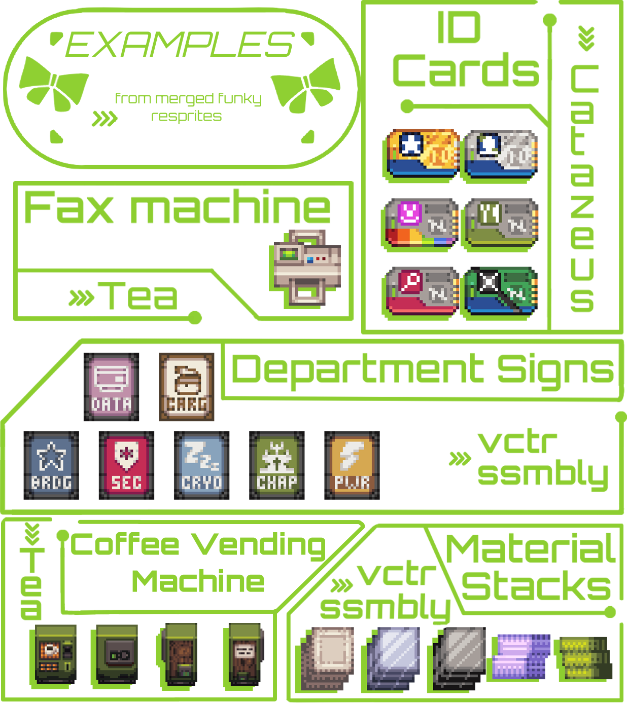
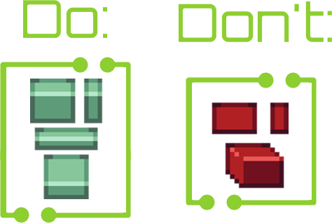
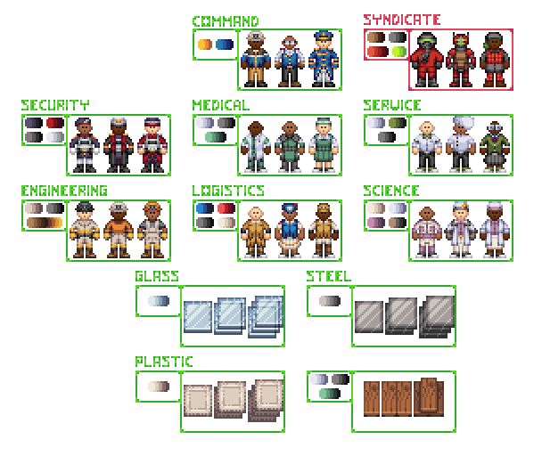
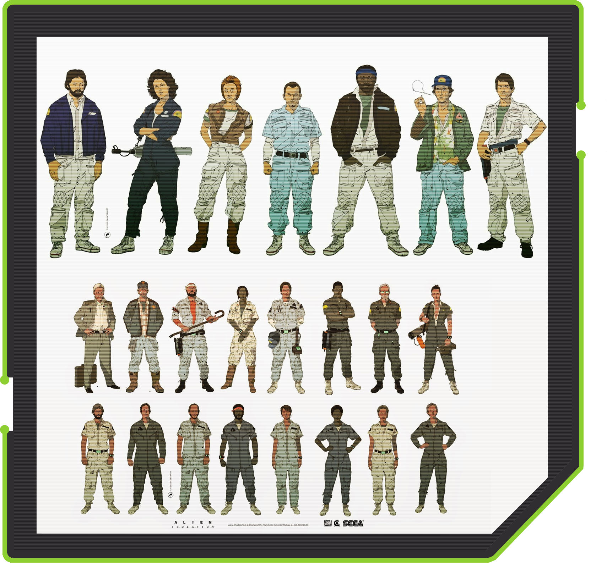
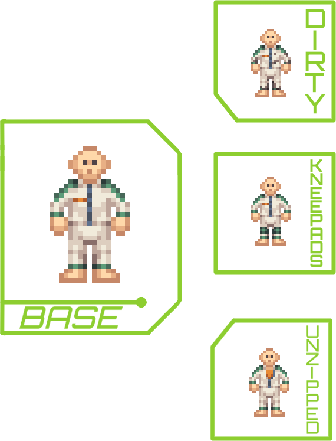
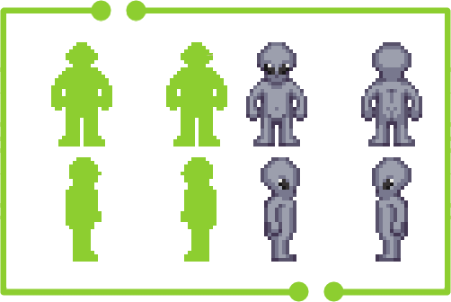
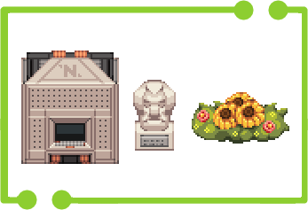
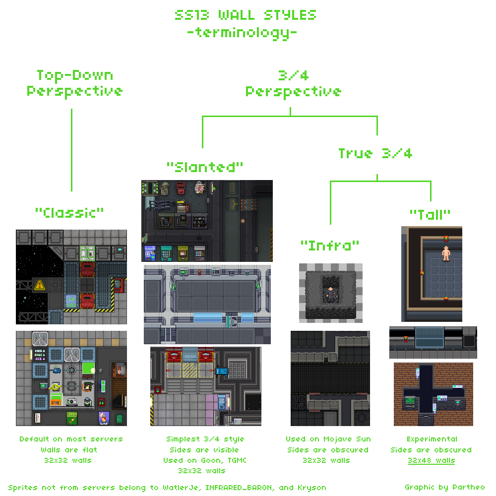

# 
 Style Overview

- Funky utilizes a palette, combining some colours from [ArmaZen's Zenit-241](https://lospec.com/couvrefeuxf)
    and [Adigun A. Polack's AAP-SPLENDOR 128](https://lospec.com/adigunpolack) palettes to form the
    [SplendorStation-176](https://github.com/vectorassembly/splendorstation/blob/main/splendorstation-176.gpl)
    palette. Using colours outside the palette is negotiable, but will ordinarily not be allowed.
- Ordinary objects are oftentimes very shaped, with inorganic objects trending towards squares/rectangles
    and organic ones being a little more loosely enforced. Things such as mugs, plates, bowls, terminals,
    etc. shouldn't feature a lot of circular shapes.
- Sprites should only be using up to 4 shades of the same colour, mono-colour items may need up to 5.
- Avoid using transparent pixels. There are only a few exceptions, like lit states for things 
    like flashlights and helmet flashlights.
- ALWAYS, ALWAYS, ALWAYS use examples from already merged sprites to help guide your style. This document
    would need to be 100+ pages long to cover every single use-case or exception.

# 
 Perspective

The majority of the sprites are done at 3/4 perspective, either from an upwards or downwards angle depending
on which looks more natural and appealing.

Generally, the goal is for items to be easily identifiable while looking good when placed in the world. 
This means, 99% of the time, an object should never face the camera directly.

Avoid cabinet perspective, where the sprite is tilted and its side is visible.
Generally, this only works for very few objects such as bags. 
Objects such as tablets, briefcases, machines, terminals, etc. should never be done in cabinet perspective.

# 
 Colours

Funky palette: https://github.com/vectorassembly/splendorstation/blob/main/splendorstation-176.gpl

Another thing to keep in mind is to avoid low-contrast colours. The palette solves this by having
very high-contrast colour sets, but sometimes you will be inclined to mix and match from different
colour sets, and it may end up being too low-contrast. Always check how the colours look in game.

Departments all adhere to a set of colours. While it isn't necessary to constrain clothes and
gear to each department's respective palette, it is very useful to have on-hand to match designs with a department
more easily.\
Generally, department-specific *equipment* does require the department's primary colour to be visible.
Examples being purple for science, blue for command, red for security, orange for engineering, etc.

# 
 Loadout / Uniform Design

Loadouts, uniforms and IDs are intrinsically connected as they make up the surface-level presentation
of a role. Most departments will have specific uniforms, and employees of said departments will be
expected to wear their respective uniforms.

As one might expect, this would not make for varied character customization as-is. The *Alien* franchise
gives us some guidance on how to approach uniforms through characterization of the same/similar
uniforms rather than simply making a large variety of uniforms, as this would defeat the purpose
of uniforms to begin with.\
Consider the following when designing loadout items for a specific department / job:
- each department has a primary colour, which is optional for clothing but necessary for handheld objects.
- consider the framing of the department/role
- consider the filter through which you expect the role you're designing an item for to see. 
    Security would not have anti-NanoTrasen images, descriptions, etc. as an example.
- think of loadouts as costumes for a movie. An unkempt character might have messy hair with a bandana, a
    zipped-down jumpsuit and some shoddy leather boots. Loadouts should be designed with the intent
    of having players be able to create believable characters within the context of the setting 
    while still having their characters' personalities shine through in how they dress themselves.

All uniforms follow a structure that is determined by its department / specific role, up to 3 different uniforms.
Service, dress and mess uniforms for security or jumpsuit, two-piece w/ pants and two-piece w/ skirt for botany
as examples, with futher characterization being allowed with variants of each uniform.

Command may follow the same structure or their own entirely, it depends on how detached they are from
their department.

# 
 Miscellaneous Clothes Design

These items are more loosely defined and less strict than department-specific loadout designs as they don't have an 
internal structure that they are bound by.\
This includes general accessories without department branding: hats, gloves, neck items, jackets, shoes, masks, innerclothing, etc.

It is very important to consider whether or not the article of clothing you are designing is 
appropriate for the setting, and appropriate for the roles that will have accesss to it roundstart.\
As an example, a black and red coat with a huge neon/holographic graphic on the back a la Cyberpunk 2077
would not be appropriate.\
An example of some generic and universal things that would be appropriate are things such as different coloured bandanas
for workers, simple gloves, jackets, etc. The less universal and simple the item is, the more you have to consider
the framing of the setting.

NT-branded or company-branded clothing would also be very appropriate for loadout items/variants, whereas
anti-corporation, capitalism or NanoTrasen things are generally relegated to maintenance or crafting.

If you are ever unsure, don't be afraid to ask on the Discord in the #artists dev channel.

# 
 Species Design 

One of the most important things to consider when designing new visuals for species or when designing a new species entirely
is uniqueness and adhering to the respective species' "rules".

This does not mean a species has to be as unique and outrageous as possible, but a species needs to be different
from any other species currently in the game, to lesser or greater degrees.

Visually, this is achieved by giving the species factors that are unique to to them, such as
markings and its silhouette.

However, be sure that this does not come at a significant cost to visual clarity / identity. 
Perhaps even more important than considering how unique something is, consider how clearly the visuals
are being communicated. This means two things:
- Avoid markings & hair that excessively clutters the sprite, such as a hairstyle with very messy/gradiated
    shading that covers 90% of the character's back.
- Avoid markings that obfuscate large portions of the character / species or that attempt to
    make the character / species look like another species.

A prime example of this is the late IPCs,
which featured 103 markings directly taken from other species with no modifications, as well as 
hairstyles that were 1:1 to hair that hair-having species had.
Because of this, the species had no concrete rules it adhered to and ended up lacking an identity, instead
ended up being "X & Y species but robot". Even then, this was communicated poorly visually.

# 
 Handheld Objects Design 

Handheld objects naturally adhere to the technological advancements of the setting. What this means
is that electronics are oftentimes relegated to single/dual-function computers in classic
retro/cassette futuristic fashion.

As such, handheld objects are usually more low-tech (with the occasional high-tech one being VERY rare),
not too advanced in function and battery-dependent when electronic. Tools are a perfect example of this, where
advanced, more multi-purpose or convenient tools have to be actively researched as opposed to being the standard.

The most important part of many handheld objects are their inhand states. It's *very* important that it be clear
when a character is, for instance, holding a rifle or pistol or a set of tools.\
This means that when making handheld objects, always have visual clarity at the forefront of your mind.
In pixel art, sticking to realism is not nearly as important as conveying an idea as clearly as possible.

With all this in mind, do not be afraid to exaggerate the in-hand size of a sprite if it results in a better-looking,
more clearly conveyed object.

# 
 Structures & Environment Objects Design 

There aren't many elements that are unified in this category, considering the wide variety of
materials, technology and shapes.

The one most important thing though, is shape/silhouette design. For these objects, most of all
it is important that you adhere to the shape design initially mentioned in the style overview.

Inorganic structures such as machines, statues, tables, pillars, railings, etc. should generally be more
rectangular/triangular and steer clear of more organic/loose shapes, such as circles and ovals.\
Organic structures, bushes, flowers, trees, masses of flesh / fungus, etc. inversely trend towards
more organic and looser shapes and steer clear of rectangles and rigid triangles.

The example above is arranged in a kind of sliding scale to visualize what is meant. On the left, is Arai's
SIS/TR AI core: a rigid rectangular mass of beeping lights. In the middle, is a sculpture of a stern
looking communist's face. While it may not be as rigid as the machinery, it features still many
rectangular shapes and rigid triangles. On the right is a wild bush with some sunflowers, entirely
devoid of rectangular shapes and rigid triangles.

Lastly, keep in mind the material colours in the palette guide sheet. Looking at SIS/TR's sprite, you
can immediately notice what each part is made of due it adhering to the materials' colours.\
This isn't always necessary, but it is helpful. Plastic does not *have* to be beige, it can be just about
any colour on the palette, but there needs to be some other element that makes it evident.

# 
 Walls & Tiles Design 

There are 2 important things to keep in mind with walls & tiles:
1. They do not adhere to the splendorstation palette. If there is no linked palette by the time you're
    reading this, you will unfortunately have to make use of colour picking Funky original tiles and
    seeking advice from the #artists channel if there isn't a colour that adheres to the material you're using.
2. Funky walls & windows are *slanted*. What this means is that the bottom end of the wall slants towards the top.
    See the SS13 wall style guide below for clarification.

